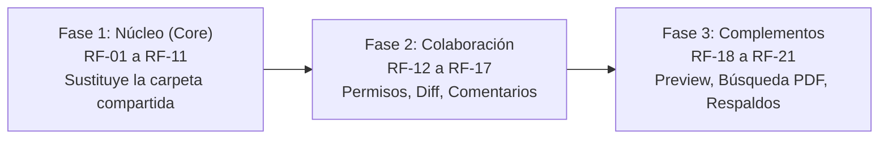

# Reglas de Gobernanza, Arquitectura y Flujo de Trabajo del Proyecto

Este documento establece las directrices obligatorias de arquitectura, seguridad, control de versiones y estándares de colaboración para todos los agentes y desarrolladores que intervienen en la **Plataforma Web de Gestión Documental con Control de Versiones**.

---

## 1. Visión y Propósito del Sistema

El sistema sustituye la carpeta compartida en red de la organización por una plataforma web centralizada, ágil y segura. Su propósito primordial es erradicar la sobrescritura accidental de documentos y mantener un historial transparente de cambios, sin imponer flujos de aprobación burocráticos ni exigir conocimientos técnicos a los usuarios finales.

---

## 2. Arquitectura Obligatoria de Tres Capas

La arquitectura es estrictamente desacoplada en tres capas cliente-servidor:

1. **Capa 1: Presentación (Frontend SPA)**
   - Construida en **Angular (TypeScript)** con biblioteca de componentes **PrimeNG**.
   - Se ejecuta en el navegador del cliente.
   - **Regla estricta**: Se comunica **únicamente** mediante llamadas HTTP REST contra la API del backend. Tiene prohibido acceder de forma directa al sistema de archivos o asumir lógicas de persistencia.
   - Lenguaje 100% natural y accesible (WCAG 2.1 AA), sin tecnicismos de control de versiones.

2. **Capa 2: Lógica de Negocio y Control (Backend API)**
   - Construida en **Python** con **FastAPI**.
   - Expone una API REST con formato JSON, versionada bajo el prefijo unificado `/api/v1`, documentada con **OpenAPI/Swagger**.
   - **Regla estricta**: Es la **única capa** autorizada para acceder a la base de datos y al almacenamiento físico de binarios. Centraliza la autenticación, autorización jerárquica por carpetas, control de concurrencia y el registro de bitácora.

3. **Capa 3: Persistencia Dual (Base de Datos + Sistema de Archivos)**
   - **Base de Datos Relacional (PostgreSQL)**: Almacena exclusivamente metadatos, usuarios, estructura jerárquica de carpetas, permisos, relaciones de versiones, comentarios, etiquetas y la bitácora de auditoría. Estructura gestionada con **Alembic**.
   - **Almacenamiento de Binarios en Disco**: Los archivos físicos residen en el sistema de archivos del servidor, organizados en subdirectorios calculados por el hash del contenido (ej. `/storage/ab/cd/abcdef...`). La base de datos guarda únicamente la referencia a dicho hash. Se implementa deduplicación de almacenamiento.

---

## 3. Matriz de Roles y Control de Acceso (RBAC)

El sistema contempla exactamente cuatro roles de usuario. Las verificaciones de permisos deben ejecutarse de manera obligatoria en el backend en cada petición:

| Rol | Descripción y Alcance | Permisos Principales |
| :--- | :--- | :--- |
| **Administrador** | Responsable integral de la plataforma. | Gestión de usuarios, asignación de roles, configuración de permisos por carpeta, ejecución de respaldos/restauración, consulta de bitácora completa y **liberación forzada de bloqueos**. Acceso total. |
| **Editor** | Personal operativo que produce y modifica documentos. | Crear y organizar carpetas; subir archivos y nuevas versiones; bloquear archivos para edición; comentar; solicitar revisiones opcionales no vinculantes. |
| **Revisor** | Persona asignada puntualmente para dar visto bueno opcional. | Consultar archivos autorizados; marcar una versión como *revisada* o *con observaciones*; añadir comentarios técnicos. **Nunca bloquea la subida ni descarga de archivos**. |
| **Lector** | Personal general de consulta. | Navegar carpetas autorizadas, previsualizar y descargar versiones de archivos. **Prohibido subir, modificar, bloquear o eliminar**. Cualquier intento no autorizado responde HTTP 403 y se audita. |

> [!IMPORTANT]
> **Principio de Mínimo Privilegio**: Ningún archivo o binario es accesible por URL directa sin pasar por autenticación JWT y validación explícita de permisos de lectura sobre la carpeta contenedora.

---

## 4. Reglas Críticas de Negocio

### 4.1 Inmutabilidad Estricta de Versiones
- Cada versión subida a la plataforma es **estrictamente inmutable**. Jamás se sobrescribe, edita o altera físicamente un archivo existente.
- Cada nueva versión genera un registro con:
  - Número entero consecutivo incremental (v1, v2, v3...).
  - Identificador del autor y marca de tiempo UTC inalterable.
  - Comentario obligatorio descriptivo del cambio introducido.
  - Tamaño exacto en bytes y hash criptográfico **SHA-256**.
- **Atomicidad**: La subida de una versión es una transacción atómica (registro en DB, guardado físico del binario y actualización del puntero de versión vigente). Si algún paso falla, se ejecuta rollback total sin dejar binarios huérfanos ni metadatos inconsistentes.
- **Restauración sin Pérdida de Historial**: Cuando un usuario restaura una versión previa (ej. restaurar la versión 2 en un archivo que va en la versión 5), el sistema **no borra** las versiones 3, 4 ni 5. Crea una **nueva versión (versión 6)** cuyo contenido coincide con la versión 2, registrando al usuario que ejecutó la restauración y el comentario correspondiente.

### 4.2 Control de Concurrencia y Bloqueo con Expiración (*Lease Lock*)
- Para prevenir la sobrescritura accidental (dos usuarios editando en paralelo), un usuario con permiso de edición puede **bloquear** un archivo al iniciar su trabajo local.
- Mientras un archivo se encuentra bloqueado:
  - Otros usuarios pueden consultarlo y descargarlo libremente.
  - Otros usuarios **no pueden** subir nuevas versiones ni bloquearlo; el sistema les informará quién tiene el bloqueo y desde qué hora.
- **Liberación del bloqueo**:
  1. Automática: al subirse con éxito la nueva versión.
  2. Voluntaria: si el editor cancela la edición explícitamente.
  3. Por expiración (TTL): el bloqueo cuenta con una expiración temporal configurable para evitar bloqueos huérfanos por olvido o desconexión.
  4. Forzada: reservada exclusivamente para el **Administrador**, quedando registrada la acción en la bitácora.

### 4.3 Bitácora de Auditoría de Solo Inserción (*Append-Only*)
- Toda acción relevante (inicios de sesión, subidas, descargas, eliminaciones lógicas, restauraciones, bloqueos, liberaciones forzadas y rechazos de acceso 403) se almacena en la tabla de bitácora.
- **Inalterabilidad**: La tabla de bitácora no expone endpoints ni mecanismos de edición o eliminación desde la aplicación.

### 4.4 Papelera y Recuperación
- La eliminación de carpetas y archivos es lógica (*soft-delete*).
- Los elementos eliminados se mueven a una papelera temporal con retención configurable, desde la cual pueden ser restaurados íntegramente con todo su historial de versiones intacto.

---

## 5. Plan de Entrega Incremental en Tres Fases

El desarrollo debe organizarse de forma modular y progresiva. Cada fase debe culminar con una versión completamente funcional y desplegable:

1. **Fase 1: Núcleo Indispensable (RF-01 a RF-11)**
   - Autenticación JWT y administración inicial de usuarios/roles.
   - Explorador de carpetas multinivel y gestión de archivos.
   - Versionado atómico con hash SHA-256 y comentario obligatorio.
   - Bloqueo de archivos con expiración temporal configurable.
   - Búsqueda básica por nombre, extensión, autor y fecha.
   - Papelera de reciclaje y bitácora de auditoría base.
2. **Fase 2: Colaboración Interdepartamental (RF-12 a RF-17)**
   - Permisos granulares de carpeta (lectura, edición, administración).
   - Comparador de versiones (metadatos generales y diff de texto plano).
   - Etiquetas/categorías y comentarios con menciones.
   - Revisión opcional de versiones (marcado no bloqueante) y notificaciones.
3. **Fase 3: Complementos Avanzados y Resiliencia (RF-18 a RF-21)**
   - Visor integrado en navegador para PDF e imágenes.
   - Búsqueda de contenido dentro de archivos (PDF y texto plano).
   - Enlaces temporales de consulta externa con caducidad.
   - Sistema de respaldos programados (DB + binarios) y restauración administrativa.

---

## 6. Convenciones de Coordinación de Agentes

1. **Contrato de API Primero**: Cualquier desarrollo de interfaz o backend debe sustentarse en los esquemas OpenAPI acordados para evitar desalineaciones.
2. **Sin Código en la Fase de Definición**: Ningún agente generará código de producción sin haber validado el modelo de datos y las pruebas asociadas.
3. **Cobertura de Pruebas**: Se exige una cobertura mínima de código del **70%** en los módulos críticos (versiones, concurrencia/bloqueo y permisos).
